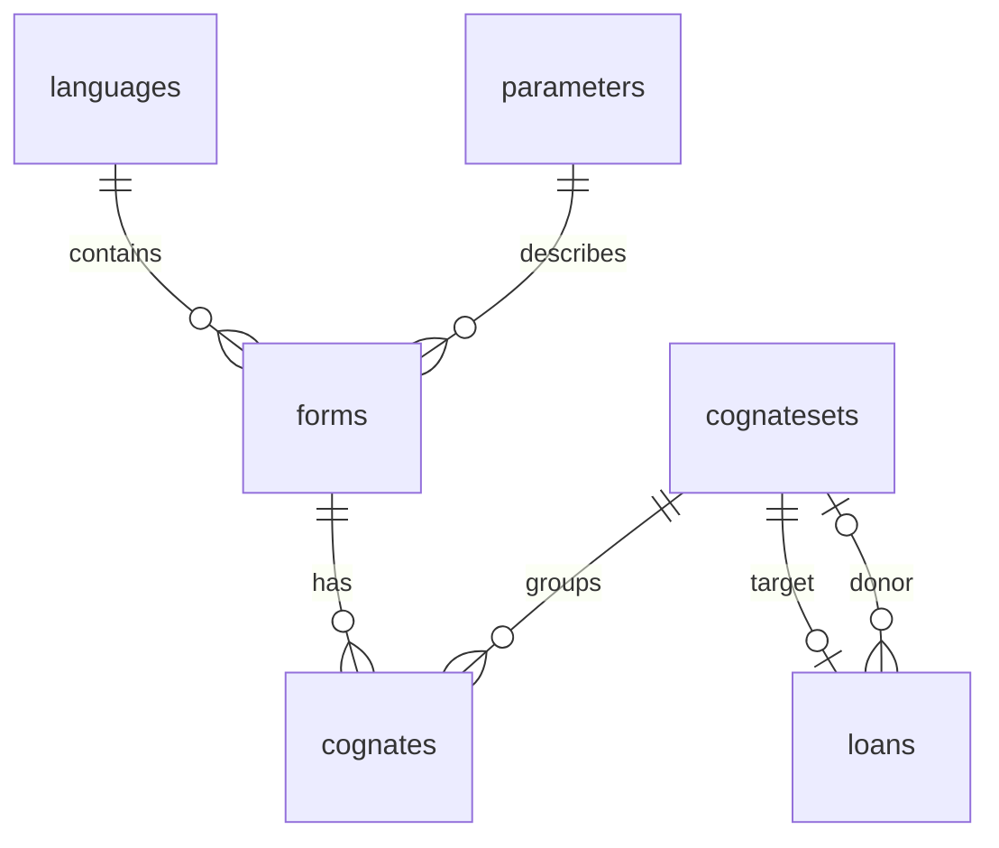

# Language Routes — Database Design

**Developers:** Dennis & Neylan  
**Course:** Engineering in Python  
**Approved scope:** Stage 1B — schema and database utilities only

## Purpose and source

The SQLite database will connect recorded forms with languages, concepts, and
cognate sets. Stage 1B creates empty tables; it does not read linguistic records
into the database. All original files in `data/raw/cldf/` remain unchanged.

The schema follows the actual CSV headers and `cldf-metadata.json`. Every column
from all eight source tables is retained with its original name and order. This
includes currently empty fields, source citations, comments, segment strings,
original and calculated roots, and language dating/classification fields.

Dataset attribution: Heggarty, Paul & Anderson, Cormac & Scarborough, Matthew
(2024), *Indo-European Cognate Relationships database (IE-CoR version 1.1)*,
Max Planck Institute for Evolutionary Anthropology. The supplied metadata records
repository provenance `v1.2-2-g978730b` separately. See the
[project README](../README.md#dataset-and-attribution) for the citation, source,
and CC BY 4.0 license links.

## Tables and keys

A **primary key** uniquely identifies a row. A **foreign key** refers to the
primary key of another table and prevents references to nonexistent records.

| Table | Purpose | Primary key | Foreign keys |
| --- | --- | --- | --- |
| `languages` | Language varieties, names, coordinates, historical status, and classification | `ID` | None |
| `parameters` | Concepts, definitions, and Concepticon references | `ID` | None |
| `forms` | Recorded forms and their spelling/phonetic information | `ID` | `Language_ID` → languages; `Parameter_ID` → parameters |
| `cognatesets` | Root information, supporting evidence, and set annotations | `ID` | None |
| `cognates` | Individual judgements assigning forms to cognate sets | `ID` | `Form_ID` → forms; `Cognateset_ID` → cognatesets |
| `loans` | Borrowing annotations associated with a target set | `Cognateset_ID` | Target and optional `SourceCognateset_ID` → cognatesets |
| `authors` | Dataset contributor names and profile information | `ID` | None |
| `clades` | Language-classification groups and their hierarchy fields | `ID` | None |
| `dataset_imports` | Application bookkeeping for successful future imports | `import_id` | None |



The four relationships involving forms and cognate assignments are explicitly
declared in the CLDF metadata. The two loan relationships are an additional,
documented application constraint: every populated target and source-set reference
was checked against the supplied cognate sets. Donor-set references may be `NULL`.
The loans primary key follows the metadata and permits one loan annotation row
per target set in this snapshot. This is not a universal model of borrowing events.

Foreign-key deletion/update behaviour uses SQLite's default `NO ACTION`: removing
a referenced parent fails rather than silently removing related records. There
are no cascading deletions.

## Values, missing information, and accuracy

- **Original identifiers use `TEXT`.** This preserves leading zeros and composite
  IDs. The future importer must read IDs as strings before inserting them.
  `Local_ID`, `Concepticon_ID`, `proposedAsCognateTo_pk`, and `supersetid` also remain
  text. The latter two are identifier-like fields even though the metadata labels
  them integers. Numeric measurements, scale values, and hierarchy levels retain
  integer or real types.
- **Primary keys are unique and non-null.** Blank or space-only source IDs are
  rejected. The application also requires the four core foreign-key fields, plus
  nonblank `Value` and `Form`. All of these fields are populated in this snapshot.
  Requiring the core references is an application rule stronger than the metadata's
  optional reference declarations; incomplete future records must be reported.
- **Optional values use SQL `NULL`.** Python represents this as `None`. Optional
  fields are not filled with guessed roots, coordinates, or false booleans.
  Stage 1C must explicitly convert missing CSV values; this schema performs no
  automatic CSV cleaning.
- **Booleans use `INTEGER` with a `CHECK` constraint.** Valid values are `0`, `1`,
  or `NULL`. This applies to historical/fossil status, loan/doubt flags, and the
  cognate-set and loan-event flags. No boolean defaults to false.
- **Coordinates use `REAL`.** Latitude must be between -90 and 90; longitude
  between -180 and 180. Either may be missing. Location explanations and historical
  status remain available for future displays. Numeric range checks do not verify
  a location's historical interpretation.
- **Roots remain separate fields.** `Root_Form`, `Root_Language`, `Root_Gloss`,
  `Root_Form_calc`, and `Root_Language_calc` are independently nullable. A language
  label is not required to exist in the languages table. No root is automatically
  classified as Proto-Indo-European, and calculated fields are not substituted
  for supplied root fields.
- **Unicode text is stored as supplied.** No case folding, accent removal, trimming,
  or normalization is applied by the utilities. CHECK expressions inspect required
  values without rewriting them. Future search keys must be derived separately.
- **STRICT tables enforce storage types.** SQLite rejects values that cannot be
  converted to their declared type, such as nonnumeric coordinates. SQLite can
  still convert compatible values, so explicit importer validation remains needed.

`Cognate_Detection_Method` has the metadata's default, `expert`, when an INSERT
omits the column. An explicitly supplied `NULL` remains unknown.

## Relationships deliberately not enforced

`Author_ID`, `revised_by`, and `Source` contain lists or citation strings rather
than single database references. They are preserved as text, with their original
separators and citation qualifiers. Contributor link tables and structured
bibliography handling can be discussed later if useful.

`Clade` contains labels; `clade_name` matches a classification name in this
snapshot, but the metadata does not declare that name as a foreign key. Neither
is forced to reference `clades.ID`.

`proposedAsCognateTo_pk` records a proposal whose semantics need confirmation.
`supersetid` does not consistently match cognate-set IDs. Both are retained
without foreign keys. The proposal scale is stored without assigning meanings
to its numerical levels.

No uniqueness constraint is placed on `forms(Language_ID, Parameter_ID)`:
alternative forms exist for the same language and concept. Likewise, `Form_ID`
is not unique in `cognates`; ten source forms have two memberships. Assignment
IDs remain the only source-declared assignment uniqueness rule.

## Future searches and provenance

A future search will find a form, follow its assignments to cognate sets, and
retrieve the other forms assigned to those sets. Joining languages supplies
names and coordinates; joining parameters supplies concept meanings. Sharing a
concept alone is not evidence of cognacy. Loan records provide separate borrowing
annotations rather than silently merging donor and recipient memberships.

Indexes on forms' language/concept references, assignments' form/set references,
and loans' donor reference support these joins. Word-search indexes and normalized
keys are deferred until the search stage defines matching behaviour.

`dataset_imports` is an application table, not a linguistic source table. It has
an internal integer `import_id`, UTC `imported_at` timestamp, dataset title,
bibliographic citation, source URL, optional source revision, license URL,
metadata SHA-256 digest, and optional notes. The digest must be 64 hexadecimal
characters. A metadata digest identifies the metadata file, not all CSV contents;
full per-file provenance may be added when the import manifest is designed.

No import-history record is created during initialization. Stage 1C should record
a successful import in the same transaction as its data. This table is an import
log, not support for storing multiple dataset versions side by side: original
source IDs remain unique across each linguistic table.

## Python utilities and transactions

The implementation is in `language_routes/database.py`; the SQL is next to it in
`language_routes/schema.sql`. Module-relative paths make schema lookup independent
of the shell's current directory.

| Function | Behaviour |
| --- | --- |
| `connect_database(path)` | Open a file connection, enable/verify foreign keys, and return it to the caller |
| `close_connection(connection)` | Close the connection; uncommitted writes are discarded |
| `database_connection(path)` | Context manager: commit on success, roll back on an exception, always close |
| `create_tables(connection)` | Apply the bundled schema in an explicit transaction; roll back on failure |
| `initialize_database(path)` | Create parent folders, apply the schema, close the connection, and return the absolute path |

Paths are filesystem paths. Relative custom paths use the current working directory;
the default is always the project's `data/processed/language_routes.sqlite3`.
Resolved destinations inside `data/raw` are rejected before opening a database.

A **transaction** groups database changes into one operation: commit keeps the
changes, and rollback undoes them. The utilities explicitly select SQLite's legacy
transaction mode so opening a connection does not start a transaction before
`PRAGMA foreign_keys = ON`. Ordinary writes start transactions. Foreign-key
enforcement must be enabled separately for every connection.

`create_tables` refuses connections with pending transactions because Python's
`executescript` could otherwise commit caller-owned work unexpectedly. Its explicit
`BEGIN`/`COMMIT` covers all schema statements. On failure it rolls back, although
a newly created empty file or parent folder may remain. The context manager closes
the connection even when an exception occurs; SQLite's own connection context
manager alone would not close it.

`CREATE TABLE IF NOT EXISTS` makes repeating initialization safe for the same
schema and preserves existing rows. It does not verify, replace, or migrate an
older incompatible schema. Schema migrations need a separate future decision.
Connections passed to `create_tables` should come from `connect_database`.

## Running and verifying

From the repository root in PowerShell:

```powershell
.\.venv\Scripts\python.exe -m language_routes.database
.\.venv\Scripts\python.exe -m language_routes.database --database .\data\processed\another.sqlite3
.\.venv\Scripts\python.exe -m pytest -q
```

The first command initializes the default file; the second illustrates an optional
custom path and is not required. Neither command imports records. Generated
SQLite files are ignored by Git.

The utilities require Python 3.12+ for explicit transaction-mode selection and
SQLite 3.37+ for STRICT tables. The project environment uses Python 3.14.7 and
SQLite 3.50.4. No additional dependencies were needed for Stage 1B.

Tests use pytest temporary paths and deliberately synthetic placeholders, never
real linguistic assertions. They cover all nine empty tables, source-column
coverage, primary keys, all six foreign keys, nullable values, coordinate/boolean
checks, Unicode, multiple memberships, provenance constraints, repeated
initialization, CLI operation, transaction rollback, and connection cleanup.

Technical references: [Python sqlite3 documentation](https://docs.python.org/3.14/library/sqlite3.html)
and [SQLite STRICT tables](https://www.sqlite.org/stricttables.html).

## Recommendations for Stage 1C (not implemented)

Use pandas to load source fields as strings, validate conversions explicitly,
and import parent tables before their dependents in one transaction. Preserve
identifiers and original text, report missing/invalid records, retain source
anomalies without silent correction, and compare source/database counts. Decide
how repeat imports should behave and how per-file hashes will be recorded before
adding import functionality. Stop for approval before starting that work.
